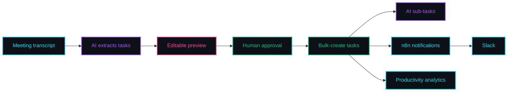

 
<!-- ============================== HERO ============================== -->

  

  
  
  

### 📄 My Resume

<b>Open to Frontend / Fullstack opportunities</b>

  
  
  

---

<!-- ============================== ABOUT ============================== -->

## 👨‍💻 About Me

<table>
<tr>
<td width="33%" valign="top" align="center">

### 🎓 Education

Information Technology  
Software Engineering

**FPT University**

2021 – 2025

</td>
<td width="33%" valign="top" align="center">

### 📍 Location

**Ho Chi Minh City**

Vietnam

</td>
<td width="33%" valign="top" align="center">

### 🌐 Languages

**Vietnamese**

**English**

</td>
</tr>
<tr>
<td valign="top" align="center">

### 💻 Current Focus

**Fullstack Development**

Strong frontend focus with React and TypeScript, plus working knowledge of Node.js and REST APIs.

</td>
<td valign="top" align="center">

### 🎯 Career Goal

Build a long-term career in **Frontend / Fullstack Development**, while developing a strong mindset for **infrastructure optimization, automation, and system efficiency**.

</td>
<td valign="top" align="center">

### 🌱 Currently Exploring

**n8n** workflow automation, AI-assisted features, and ways to improve development productivity.

</td>
</tr>
</table>

---

<!-- ============================== EXPERIENCE ============================== -->

## 💼 Experience

### Fullstack Developer | System Operator

  

- Developed and maintained internal tools and customer-facing applications.
- Managed and optimized SaaS platforms and automated workflows.
- Worked across application development, integrations, and system efficiency.

### Software Engineering Intern

  

- Labeled and prepared datasets for AI model training using LabelMe.
- Worked within a professional development environment and team workflows.
- Gained exposure to the software development lifecycle.

---

<!-- ============================== PROJECTS ============================== -->

## 🚀 Featured Projects

### 1. MicroDo — Task Management SaaS System

  
  
  
  
  
  
  
  
  
  

**The problem**

After meetings, managers often need to manually turn discussion notes into tasks, assign owners and deadlines, and break large tasks into actionable steps. Tracking progress across projects can also become time-consuming.

**Solution workflow**

**Key features**

- **Transcript-to-Tasks Pipeline:** Uses AI to extract structured tasks, assignees, and deadlines from meeting transcripts. Users review and approve tasks before bulk creation.
- **AI Task Decomposition:** Breaks complex tasks into smaller, actionable sub-tasks.
- **Team and Project Management:** Supports project collaboration, task tracking, and productivity insights.
- **Automated Notifications:** Uses n8n and Slack integrations to send task updates.
- **End-to-end Development:** Built the REST API and responsive frontend with dark/light mode.

**Impact**

- Reduced ~70% manual task creation time post-meetings.
- Processes 30-min meeting transcripts in &lt;20s.

---

### 2. NewsFlow — Real-time News Platform

  
  
  
  

- Built a responsive news interface for desktop and mobile.
- Integrated news data and search functionality.
- Added dark/light mode for a more comfortable reading experience.
- Built an intermediate backend to help address CORS issues during deployment.

---

### 3. TradersYa — Cryptocurrency Tracker

  
  
  
  

- Displays cryptocurrency market data using the CoinLore API.
- Includes search and dark/light mode.
- Built an intermediate backend to help address CORS issues during deployment.

---

### 4. CEO-Dashboard — Restaurant Management System

  
  
  
  
  

- Developed RESTful API functionality and a responsive user interface.
- Worked on frontend–backend integration.
- Contributed to a company/client project.

> 🔒 **Private project:** This is a company/client project. Its source code is private and cannot be publicly shared.

---

### 5. BEESRS — Capstone Project

**Broadcom Employee Engagement & Social Recommendation System**

  
  
  
  

- Built an interactive interface for location discovery and social interaction.
- Integrated map features using TrackMaps API.
- Developed chat and event management components.
- Designed to help employees living abroad discover places and social activities.

---

<!-- ============================== TECH STACK ============================== -->

## 🧰 Tech Stack

### ⚡ Frontend Development

  
  
  
  
  
  
  
  
  
  
  
  
  

### 🖥️ Backend Development

  
  
  
  
  

### 🗄️ Databases

  
  
  
  
  

### 🛠️ Tools & Automation

  
  
  
  
  
  
  
  

### 🚀 Project Management & Deployment

  
  
  
  
  
  

---

<!-- ============================== GITHUB STATS ============================== -->

## 📊 GitHub Statistics

  
  

  

  

## 🏆 GitHub Trophies

  

## 🐍 Contribution Snake

  

---

<!-- ============================== FOOTER ============================== -->

### 💬 Let's Connect!

**Open to Fresher / Junior Frontend & Fullstack opportunities.**

Feel free to reach out!

  
  
  

